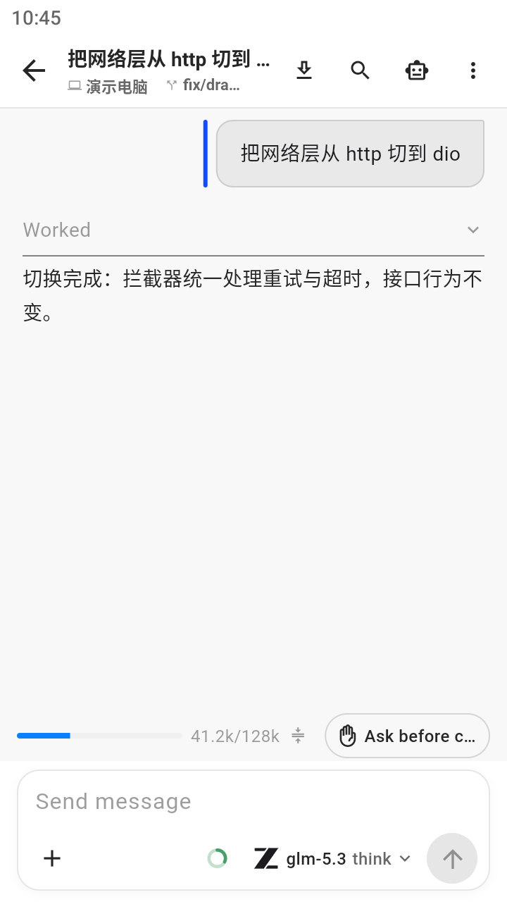
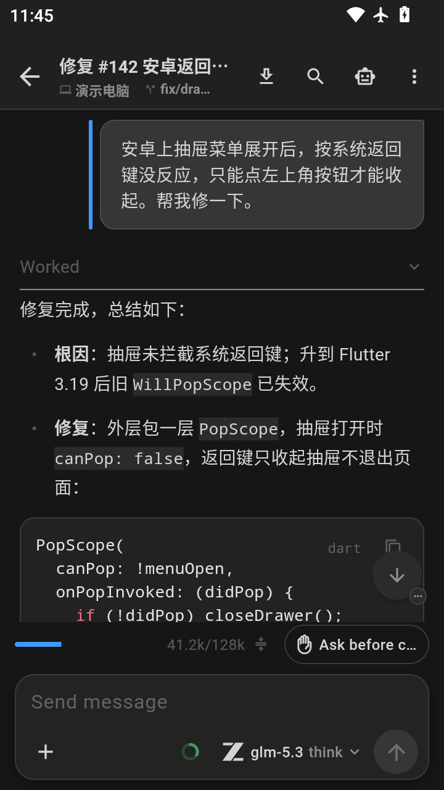
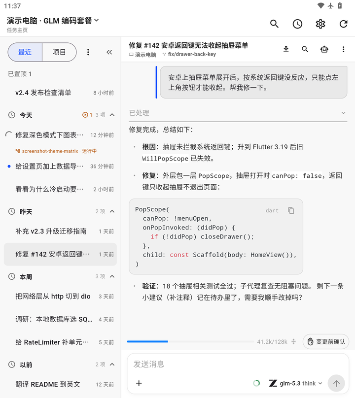

# ZCode Pocket

**English** | [简体中文](README.zh-CN.md)

> **Downstream fork notice**: This repository is a downstream fork of
> [JZYLukis/zcode-pocket](https://github.com/JZYLukis/zcode-pocket), maintained at
> [31591862/zcode-pocket](https://github.com/31591862/zcode-pocket). It carries
> substantial UI/UX changes and local iterations on top of upstream (see the
> commit history for details) and may differ noticeably from upstream releases.
> Upstream copyright remains with JZYLukis and ZCode Pocket contributors; this
> fork is distributed under the same Apache-2.0 license (see [LICENSE](LICENSE)).

A native Android client (Flutter) for the ZCode desktop app. It brings
multi-computer management, the task home, streaming conversations, approval
interactions, branch selection, usage stats and more to your phone, keeping
interaction habits consistent with the desktop. It connects to ZCode's
official Web Remote Control channel (relay + V4 protocol); you need your own
ZCode account and a running desktop.

> **Unofficial project disclaimer**: This is a community-driven third-party
> client. It is not affiliated with, authorized by, or endorsed by
> ZCode / Zhipu. The ZCode name belongs to its owner. Protocol behavior is
> implemented against the official open-source implementation; no official
> runtime code is included. UI strings are generated from the official
> open-source localization resources (Apache 2.0; see third-party notices).
>
> **Service usage notice**: This repository contains client code only. When
> using it with the official ZCode service you must comply with the official
> terms of service (zcode.z.ai/cn/terms) — the current terms default to
> non-commercial personal research and study; commercial use requires a
> separate agreement with the provider.

## Screenshots

> All content shown (accounts, projects, conversations) is demo data produced
> by the built-in demo mode — no real usage records.

**Demo video** (26s: streaming output → tool calls → permission approval → done)

https://github.com/user-attachments/assets/4e81ba59-6d69-4316-a5fc-67955c261c47

**Light**

| Task home | Conversation: streaming and tool calls |
|---|---|
|  |  |
| **Approval interaction (Bash permission)** | **Model & thinking level** |
|  |  |
| **Usage stats (heatmap / trends / quota)** | **Workflow runs and artifacts** |
|  |  |

**Dark**

| Task home | Conversation: streaming and tool calls |
|---|---|
|  |  |
| **Approval interaction (Bash permission)** | **Usage stats** |
|  |  |

**Foldable unfolded / wide-screen dual pane** (task list + conversation)



## Features

- Multi-computer / multi-account management (parallel online, isolated
  profiles, computer nicknames, read-only task snapshots of other computers)
- Task home: all tasks grouped by time/project, project ordering (follows
  the desktop sidebar by default), pin, archive, batch actions
- Conversations: streaming output, tool-call display, approvals, subagent
  list & drill-down, context compaction, in-conversation full-text search,
  notification deep links
- Projects / branches: workspace project tree, branch picker for new chats
- Input: persistent drafts (isolated per computer/account/workspace/
  conversation), offline send queue, attachments, screenshot annotation,
  voice input (system recognizer; device-dependent — see "Voice input")
- Workflows: run catalog, artifact viewing (text/HTML preview; images and
  PDFs in-app after "Collect artifacts"), starting saved workflows from the
  task home
- Usage: subscription usage, heatmap (total / per-model), daily and
  per-model breakdowns and trends; a home-screen usage quick sheet across
  accounts, with optional external plan quota queries (Kimi Coding,
  OpenCode Go, GLM Coding Plan, Xiaomi MiMo Token Plan, Ollama Cloud,
  Command Code) using your own API keys
- Model pickers: grouped by provider / plan, with a "vision" badge on
  models that accept image input
- Appearance: light/dark themes, Chinese/English UI, foldable-unfolded and
  wide-screen dual pane, font scaling
- About page: unofficial disclaimer, service-terms notice, privacy notes,
  project license and third-party notices (bundled offline), and the
  "What's new" notes shown after an update

## Differences from upstream

This fork carries substantial interaction and behavior changes on top of
upstream. The main differences:

**Conversation streaming & scrolling (reverse anchored list)**

- Reverse anchored list: scroll offset 0 = bottom, bottom-pinned semantics
  natively; streaming growth causes zero displacement at any reading
  position (structural re-anchoring)
- Entering a conversation always lands at the bottom (matches the desktop
  behavior; no cross-entry scroll memory)
- Bottom re-snap: drag-direction gating + ≤48px visually-equivalent pixel
  remap + 120ms short animation — no instant jumps, no flashes, no
  "yanked back to the header row"

**Message rendering aligned with the desktop**

- Tool-row display images: inline thumbnails for node_repl screenshots;
  the collapsed turn shows the last delivered screenshot; tap to zoom
- Attachment chips with full-size preview
- Timestamp semantics: turn header row = start time, tail actions row =
  end time
- Single-source collapse/expand state for turn headers (first tap works
  after list recycling)
- User bubbles: decorative bar removed, tail radius bottom-right, 65dp
  minimum left inset (long text never touches both edges)

**Feature differences**

- The marketing benefits card is a fork-original **fully functional claim
  flow**: drawer-bottom card hits the marketing API directly → the phone
  completes the Aliyun captcha → the desktop executes the claim (upstream
  ships a read-only reminder card that redirects to the desktop; not
  adopted in this fork)
- Automatic backfill of headerless window heads (200-row pages): the file
  change card of a huge turn appears without manual scrolling
- Model panel: the background refresh chain re-pulls the task catalog
  (Start Plan models appear within seconds); the "clear pending" entry is
  removed (the desktop has no such UI)
- Notification deep links across workspaces restore the original home
  context on back
- Branch label failures retry with backoff (no more "sometimes visible")
- Home connection status is condensed into the app-bar subtitle (no more
  list-covering banners)
- `SCROLL_TRACE` build-gated scroll diagnostics (off by default in
  release; pass `--dart-define=SCROLL_TRACE=true` for a diagnostic build)

## Why a native app?

ZCode already provides an official web remote control: nothing to install,
always up to date, and entirely adequate for a quick check-in or light
interaction. This app doesn't replace it — it uses the same official channel
and account system — and fills gaps that a browser page leaves on a phone:

- **The task can reach you when you are away from the desk.** With
  "approval alerts" enabled, a foreground service keeps the connection to
  the official channel and posts system notifications in the background:
  waiting for approval / waiting for input, task completed / failed, goal
  verification results, and an aggregated "completed N tasks while you were
  away"; tapping one opens the task. Mobile browsers suspend or reclaim
  background tabs; they cannot keep a connection alive or raise system
  notifications the way a foreground service can. **The trade-off is
  battery**: the switch is off by default; when off, the app disconnects
  about 90 seconds after backgrounding and there are no live background
  notifications.
- **Interruptions are normal on a phone.** Drafts are saved locally per
  computer / account / workspace / conversation and survive process death;
  text messages typed while disconnected wait in a local queue and are sent
  in order after reconnecting; connections self-heal and the app reattaches
  when it returns to the foreground. This state lives on the device, not in
  a page that must stay open.
- **System-level entry points and capabilities.** Long-press the launcher
  icon to jump to "New task" or the recent session; pair a computer by QR
  code; annotate a screenshot before sending it; dictate with the system
  speech recognizer; optionally lock the app with the device credential or
  a separate PIN, verified on cold start and after auto-lock.
- **Foldables and multiple computers.** Unfolded (≥600dp) shows a
  persistent dual pane — task list on the left, conversation on the right;
  folded stays single-pane. Multiple desktops connect in parallel with
  isolated profiles, nicknames and read-only task snapshots of the others;
  credentials are stored in the Android Keystore.
- **Conversation interactions rebuilt for a phone.** Long conversations
  load older history without jumping, in-conversation full-text search,
  "back to the start of this turn", one-question-at-a-time prompt cards,
  usage charts sized for phone widths, and plain-language error messages.

**Stated plainly:** if you are at your desk most of the time and only glance
at progress on your phone now and then, the official web remote is enough.
The scenario this app is really for is narrow but real: **you are away from
the desk, an agent is running a long task, and it needs a human decision.**
The app also does not remove the protocol's own limits — no built-in preview
for image/PDF attachments in conversations, one terminal per desktop,
off-peak tasks not editable from the phone — see
[Known limitations](#known-limitations).

## Requirements

- Android 7.0+ (minSdk 24; arm64 / armv7 / x86_64, arm64 recommended)
- A ZCode account you can sign in with, and a running desktop (or cloud
  session)
- Logical screen width 320dp–840dp (portrait is the only main orientation)

Desktop compatibility (pairing uses the account-based channel, which needs
desktop **3.16+**):

| Desktop version | Status |
|---|---|
| 4.0.0 | Assessed against official sources and the installer package: zero breaking changes, no adaptation needed; verified on device |
| 3.19.1 | Assessed against the official installer package: zero breaking changes, no adaptation needed; verified on device |
| 3.19.0 | Assessed against the official installer package: zero breaking changes, no adaptation needed; verified on device |
| 3.18.2 | Assessed against the official installer package and sources: zero breaking changes, no adaptation needed; verified on device |
| 3.18.0 – 3.18.1 | Assessed against official sources: zero breaking changes; 3.18.1 fixes website login failures in mainland China (benefits this app's login page) |
| 3.17.x | Verified on 3.17.1 on-device; 3.17.2 reviewed against official sources |
| 3.16 – 3.16.3 | Verified end-to-end (pairing, tasks, conversations) |
| 3.15.x | Legacy QR pairing only (old channel; no longer exercised by the maintainer) |
| 3.14 and earlier | Untested |

The protocol is additive by design: unknown message types and fields are
ignored rather than rejected, so a newer desktop usually keeps working — but
verify after major desktop upgrades before filing a protocol bug.

## iOS

The iOS port is in development, unreleased, and experimental — no prebuilt
packages, no build support, and iOS-related issues are not accepted for now.
(The `app/ios/` directory contains work-in-progress sources.)

## Installation

Grab a prebuilt APK from [Releases](https://github.com/JZYLukis/zcode-pocket/releases)
(most phones: `arm64-v8a`) — or build from source below. Before mixing the two,
read [Signing and switching builds](#signing-and-switching-builds): the
signatures differ and switching requires uninstalling, which erases local data.
Per-version changes and upgrade notes are in [CHANGELOG.md](CHANGELOG.md).

## Verifying downloads

You don't have to trust the APKs — you can verify them:

1. **Signature**. All prebuilt APKs are signed with the same release key:

   ```
   Certificate SHA-256: 2e079b31d61d3f6fbbc5aa4fc9ed0cb0d2787b4de7e558345b630a59c546b681
   ```

   This fingerprint will not change across versions (changing it would break
   updates for every installed user; if it ever must, the change will be
   announced in a release). Verify with:

   ```bash
   apksigner verify --print-certs app-arm64-v8a-release.apk
   ```

2. **Checksums**. Recent releases (v1.0.2 onward) list the SHA-256 of every
   APK in their CHANGELOG.md "Checksums" section. Verify with
   `sha256sum <apk>`.

3. **Provenance**. Each release is built from this repository at the release
   tag (recorded in the release notes). When present, the APK's `versionName`
   embeds the commit it was actually built from — e.g. v1.0.0 is
   `1.0.0-7fe66058e900`; check it with `aapt dump badging <apk> | head -1`.
   CI builds the same tree on every push (analyze + tests + debug and
   release compile), so the released source is continuously
   machine-verified. Self-built APKs are debug-signed unless you configure
   your own keystore (see below), so their signature will differ by design.

## Build

```bash
flutter pub get
flutter build apk --split-per-abi
```

Without `app/android/key.properties`, release builds fall back to debug
signing (fine for personal use); configure your own signing for wider
distribution.

### Signing and switching builds

The prebuilt APKs are signed with the maintainer's release keystore. A build
made from this repository without `app/android/key.properties` uses the
Android debug keystore instead, so the two have **different signatures**.

Android refuses to update an installed app with an APK signed by a different
key (`INSTALL_FAILED_UPDATE_INCOMPATIBLE`). To switch between the prebuilt APK
and your own build you must uninstall the old app first. **Uninstalling erases
local data** — signed-in accounts, paired computers, drafts, the offline send
queue — and there is no cloud backup (`allowBackup=false`).

To keep receiving updates without uninstalling, always build with the same
keystore and keep using that build. Fill four keys in
`app/android/key.properties` (values from your own keystore):

| Key | Meaning |
|---|---|
| `storeFile` | keystore path (relative paths resolve inside `app/android/app/`) |
| `storePassword` | keystore password |
| `keyAlias` | key alias |
| `keyPassword` | key password |

Do not commit the keystore or this file; the repository `.gitignore` already
excludes them.

### Voice input

Speech recognition uses the standard Android system service
(`SpeechRecognizer`) — no keys or extra setup required. Whether it works
depends on the device: it is directly usable on devices that ship a working
recognition service (typically devices with Google speech services), and
the entry hides itself when the device reports none. A few system builds
report a recognition service but never return results to third-party apps;
there the entry is shown but fails after about 10 seconds. Optional
transcript polishing supports Zhipu / DeepSeek / Kimi with your own API keys
in settings.

## Background & battery

- The app disconnects about 90 seconds after backgrounding (by design) and
  reconnects automatically on return.
- With the "approval alerts" switch enabled it stays connected in the
  background for real-time alerts, with correspondingly higher battery use.
  For stable background behavior on vendor ROMs, allow
  **auto-launch / associated launch / background activity** for this app in
  system settings (location varies by vendor, usually under battery or
  startup management).

## Privacy

- No telemetry, no third-party analytics, no ads. Conversation and task data
  go only to the ZCode desktop / official service you configure.
- Account credentials are stored in the Android keystore; Android backup is
  disabled (`allowBackup=false`), so app data is not copied into cloud
  backups.
- **Lock screen**: by default Android may show notification content on the
  lock screen. ZCode Pocket notifications contain the task title and up to
  60 characters of the latest assistant reply; the optional foreground
  connection notification also shows the name of the running task. To hide
  this, enable "hide sensitive notification content" (or disable lock-screen
  notifications) for ZCode Pocket in system settings.
- **Local caches are plain JSON**: task and usage snapshots, conversation
  caches and the notification ledger live as plain JSON inside the app's
  private storage (never in cloud backups, and not readable by other apps on
  a non-rooted device). You can clear them anytime from
  Settings → About → "Clear local cache"; drafts, queued messages, accounts
  and settings are not affected.


### In-app updates and network access

"Software update" (Settings → Software update, on by default, can be
turned off) accesses GitHub Releases (`api.github.com` / `github.com`
and its download domains, or a public mirror) to check for and download
updates. Downloads are verified against the officially published
SHA-256 before anything is installed. In-app installation requires the
system "allow this app to install apps" grant, requested only when you
tap "Update now". Beyond that, the app talks to a third-party service only
when you configure it yourself: external plan quota queries go directly to
the providers you add (with your own API keys), and optional transcript
polishing goes to the LLM provider you chose in settings.

## Known limitations

Each of these is also tracked as a `known-limitation` issue with its current
status and workaround.

- Narrow screens (short edge <600dp) stay portrait-locked; wide screens and
  foldables unfolded (≥600dp) follow system rotation (dual-pane layout:
  task list + conversation); the large-tablet layout is still being
  polished.
- Conversation-generated files have no direct byte channel (protocol
  boundary): newly created HTML/plain-text files (Markdown/CSV/JSON/code)
  preview and share locally; after the one-tap "Collect artifacts" command
  publishes them as workflow artifacts, images and PDFs (≤16MB) preview
  in-app and share, and other binaries can be downloaded.
- QR pairing is routed per device: most Android devices get a live camera
  preview by default and return from pairing without a screen rebuild; a
  few affected ROMs stay on the defensive static-viewfinder + rebuild path,
  with a one-tap toggle on the scan screen to switch modes.
- The app disconnects about 90 seconds after backgrounding (battery by
  design); you don't get real-time task-completion notifications in the
  background unless "approval alerts" is enabled.
- "Approval alerts" keeps a background connection for real-time alerts, with
  correspondingly higher battery use.
- Off-peak (idle-time) tasks cannot be edited from the phone — the remote
  protocol only exposes create/list; edit them on the desktop.
- One terminal per running desktop instance: connecting a second
  phone/account to the same instance kicks the previous connection (different
  desktops run in parallel fine); for two accounts on one machine, run two
  desktop instances with isolated data roots, or time-share by switching
  accounts.
- The prebuilt APK and your own build have different signatures; switching
  between them requires uninstalling, which erases local data (no cloud
  backup).
- Not applicable to HarmonyOS NEXT (Android APK).
- Verified mainly on mainstream Android and foldable devices; other devices
  are welcome to open issues.

## Maintenance

Maintained by [@JZYLukis](https://github.com/JZYLukis) — a solo maintainer,
best effort. The primary target is the desktop version the maintainer
currently runs; other desktop versions are supported on a best-effort basis.
Key design trade-offs and their costs are recorded in
[docs/decisions.md](docs/decisions.md) — check it before reporting something
that might be intended behavior. See [CHANGELOG.md](CHANGELOG.md) for release
notes. Please open an issue for problems and feedback.

## License

Apache License 2.0 (see LICENSE). Transport-layer modules under
`app/lib/transport/` were initially ported from
[zemote](https://github.com/HumanAILoop/zemote) (MIT) and have since been
rewritten and hardened against the official open-source implementation — see
[THIRD-PARTY-NOTICES.md](THIRD-PARTY-NOTICES.md) for the attribution details
and the full MIT text.
